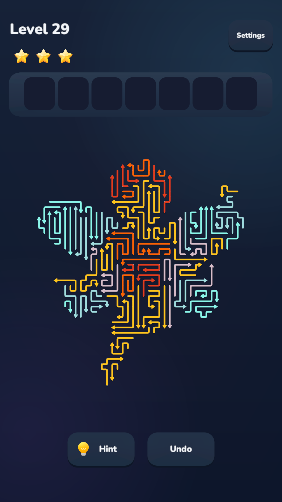
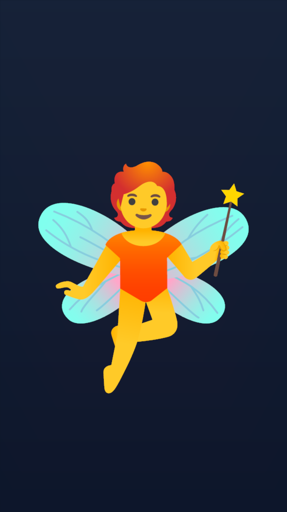
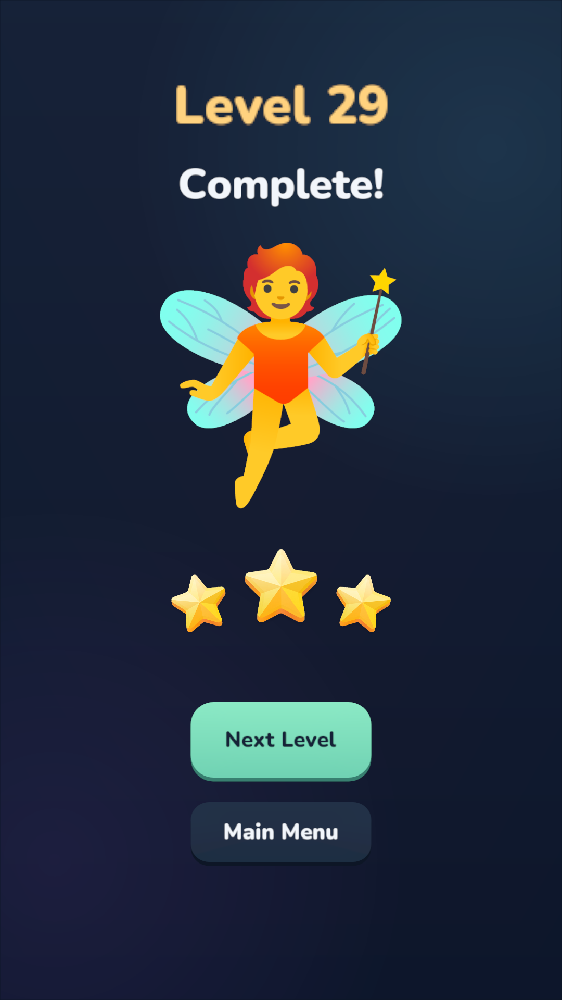
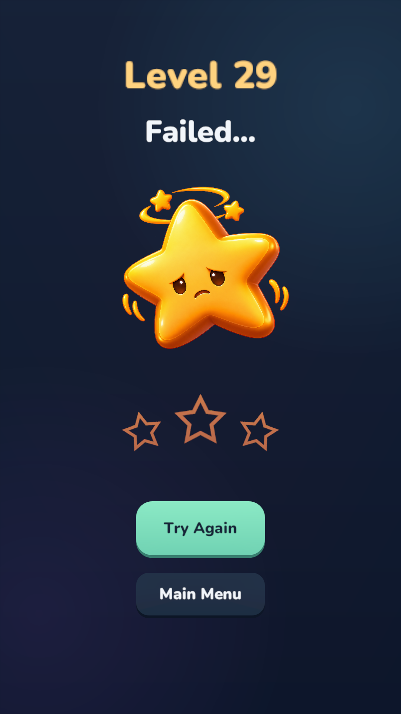
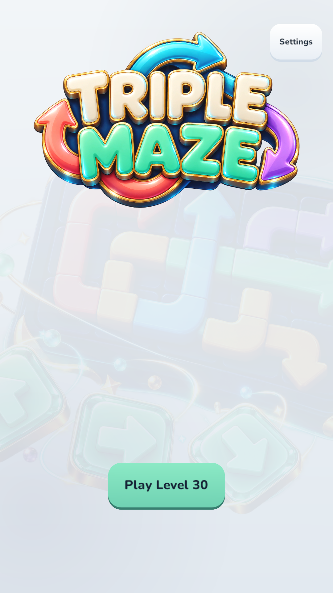
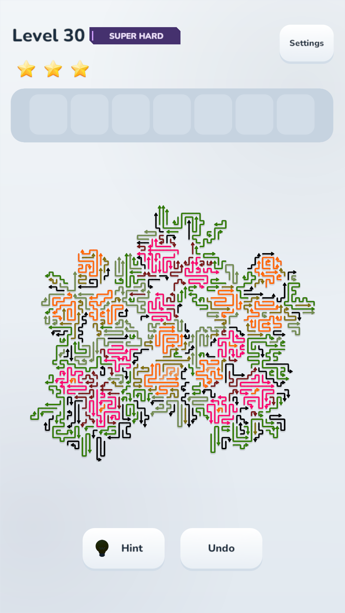
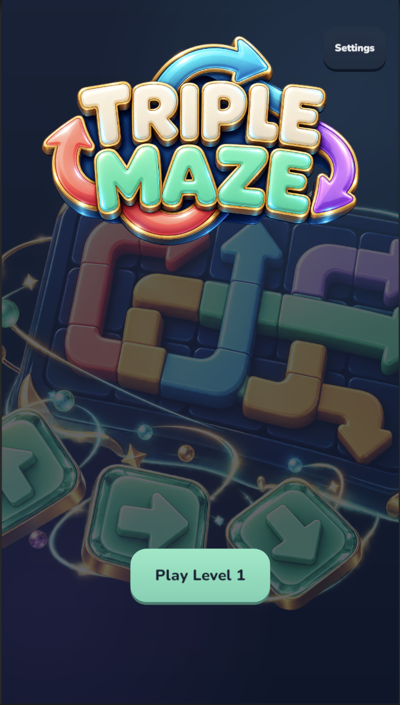

# TripleMaze

移出箭头，解开通路；凑齐同色，腾出空间。

TripleMaze 是一款将箭头解谜与同色三消结合的休闲益智游戏。箭头组成一幅幅图案，每次点击既要判断前方是否畅通，也要考虑收集栏里的颜色。随着箭头逐渐移出，藏在棋盘中的原图也会在通关后揭晓。

**[在线试玩](https://junlinr-cell.github.io/TripleMaze/)**

## 游戏画面

<table>
  <tr>
    <td width="25%"></td>
    <td width="25%"></td>
    <td width="25%"></td>
    <td width="25%"></td>
  </tr>
  <tr>
    <td align="center">关卡</td>
    <td align="center">关卡完成</td>
    <td align="center">成功结算</td>
    <td align="center">失败结算</td>
  </tr>
</table>

<table>
  <tr>
    <td width="33%"></td>
    <td width="33%"></td>
    <td width="33%"></td>
  </tr>
  <tr>
    <td align="center">浅色菜单</td>
    <td align="center">浅色关卡</td>
    <td align="center">深色菜单</td>
  </tr>
</table>

## 玩法

- **看方向，解遮挡**：点击箭头后，它会沿尖端方向移出。前方存在其他箭头时会发生碰撞，并损失一颗生命星。
- **收集同色，三枚消除**：移出的箭头进入七格收集栏，凑齐三枚同色即可自动消除。需要同时安排移出顺序和颜色搭配，避免收集栏被填满。
- **清空棋盘，揭晓图案**：清空棋盘与收集栏即可通关，并根据剩余生命获得星级结算。生命耗尽或收集栏在消除后仍然满格，则挑战失败。

## 游戏特色

- **30 个图案关卡**：围绕不同图片轮廓与配色展开，结合遮挡关系和颜色选择形成不同的解谜节奏。
- **连续操作与反馈**：支持连续点击，配合箭头拖尾、碰撞回弹、三消动画和连击反馈。
- **提示与撤回**：Hint 帮助寻找可移出的箭头；Undo 撤回上一次成功收集，方便重新安排顺序。
- **缩放与拖动**：放大观察密集区域，梳理箭头之间的通路。
- **深浅主题**：可在设置中切换浅色与深色外观。
- **自动保存**：保存闯关进度和未完成局面，使用同一浏览器时可以继续游玩。清除站点数据后，存档也会被清除。

## 运行与项目结构

游戏使用 Unity 开发，采用竖屏布局，游戏内界面为英文。点击上方在线试玩链接即可在浏览器中体验。

- `TripleMaze_webgl/`：当前 WebGL 导出包。
- `screenshot/`：本页展示的游戏截图。
- `Assets/TripleMaze/`：游戏逻辑、资源与编辑工具。
- `Assets/Scenes/TripleMaze.unity`：游戏场景。
- `Tools/Workbench/`：游戏工作台，参见[工作台使用说明](Tools/Workbench/README.md)。

WebGL 包使用 Brotli 压缩，直接部署时需要服务器提供对应的压缩响应头。仓库的 GitHub Pages 流程会在发布时解压构建文件并调整引用，保留仓库中的原始导出包。
