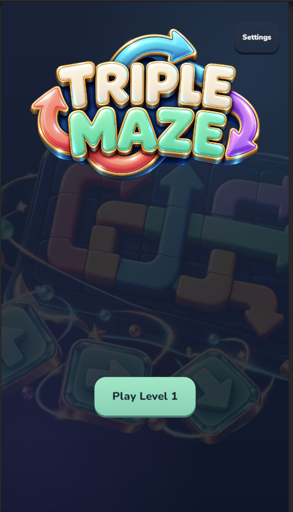
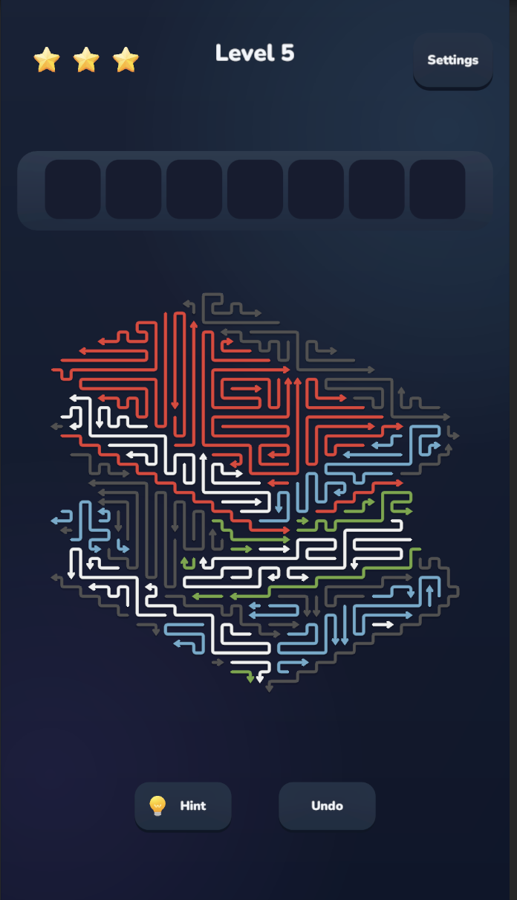
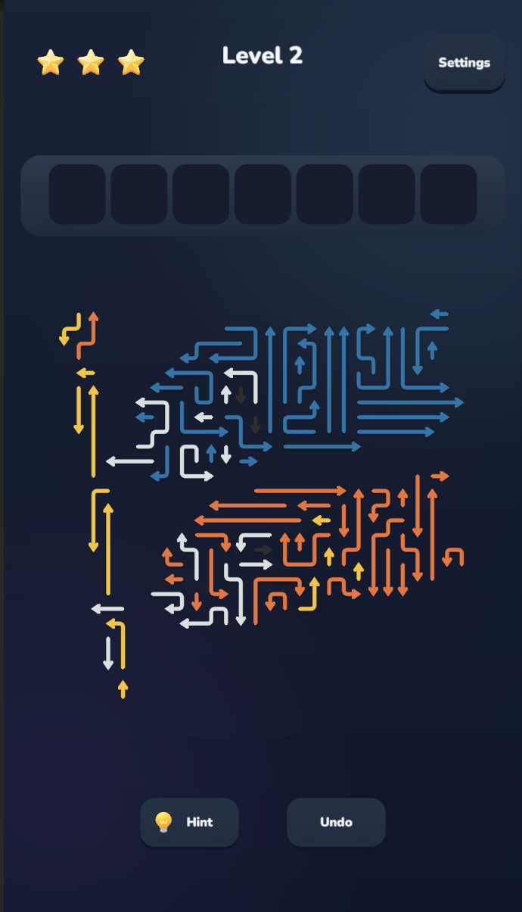
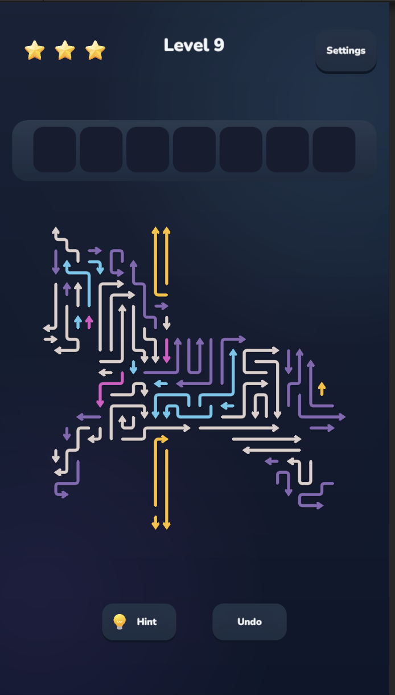
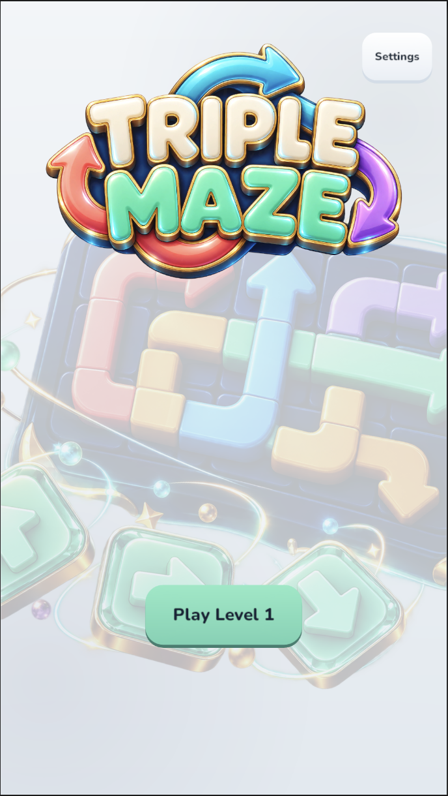
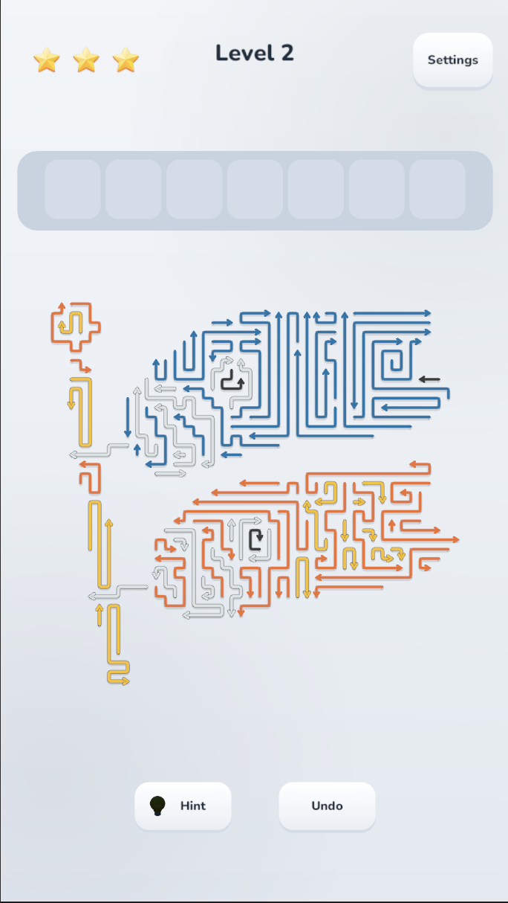

# TripleMaze

**移出一支箭头，打开一条通路；凑齐三枚同色，为下一步腾出空间。**

TripleMaze 将箭头解谜与同色三消放进同一个棋盘。每次点击都在改变遮挡关系，也在占用有限的收集空间：眼前能移出的箭头，未必就是此刻最好的选择。

**[在线试玩 →](https://junlinr-cell.github.io/TripleMaze/)**

  

## 一次点击，两层思考

**先看通路，再看颜色。** 箭头只能朝尖端方向移出，前方的箭头决定了出场顺序。移走一支，可能打开整片区域；但如果只顾解除遮挡，收集栏也可能被不同颜色塞满。

**七格空间，三枚消除。** 成功移出的箭头进入上方收集栏，同色三枚自动消除。玩家需要在打开通路与凑齐颜色之间做取舍，让每次移出都为后续操作留下余地。

<table>
  <tr>
    <td width="33%"></td>
    <td width="33%"></td>
    <td width="33%"></td>
  </tr>
  <tr>
    <td align="center">解谜中</td>
    <td align="center">原图揭晓</td>
    <td align="center">通关结算</td>
  </tr>
</table>

## 把一幅图案，解成一次通关

关卡从图片的轮廓与颜色出发，让箭头组成不同的图案。随着棋盘逐渐清空，玩家完成的不只是消除，也是在拆解一幅图形谜题。胜利后，棋盘会逐渐还原对应的图片，为解谜过程留下一个完整的收尾。

目前包含 **30 关**，每十关安排一关 **困难关（HARD）**。不同的箭头数量与遮挡关系带来节奏变化，让普通关的推进与困难关的规划交替出现。

## 连续操作，也能停下来想一想

支持连续点击、多支箭头同时移出，搭配拖尾、碰撞回弹、三消动画与连击反馈。没有倒计时，可以连贯地解开通路，也可以放大棋盘，慢慢规划下一步。

- **提示（Hint）**：高亮一支可以移出的箭头，优先考虑收集栏中已有的颜色。
- **撤回（Undo）**：撤销上一次成功收集，重新安排顺序；不会返还碰撞损失的生命。
- **缩放与拖动**：查看密集区域，找到被图案藏起来的通路。

## 挑战规则

每关有三颗生命星，点击被阻挡的箭头会扣掉一颗。生命耗尽，或三消结算后收集栏仍占满七格，挑战失败。

清空棋盘与收集栏即可通关，结算星数取决于剩余生命。失败后可以重试，成功后继续下一关。

## 深浅两种风格，随时接着玩

默认使用浅色模式，也可以在设置中切换深色，游戏会记住你的选择。

<table>
  <tr>
    <td width="50%" align="center"></td>
    <td width="50%" align="center"></td>
  </tr>
  <tr>
    <td align="center">浅色首页</td>
    <td align="center">浅色游戏页</td>
  </tr>
</table>

闯关进度和未失败的局面会自动保存，包括已经移出的箭头、收集栏和剩余生命。暂时离开后，可以接着解到一半的关卡；主动重新开始则重置当前局面。网页存档保存在当前浏览器，清除站点数据或更换设备后不会自动同步。

## 关于作品

使用 Unity 开发。游戏采用手机竖屏 9:16 布局，当前游戏内界面为英文，支持保存闯关进度与未完成局面，重新打开后可以继续。

[开发总结](开发总结.md) / [开发备忘录](开发备忘录.md)

本仓库用于网页试玩发布，Unity 源工程另行维护；字体与图片来源说明见 `licenses/`。
